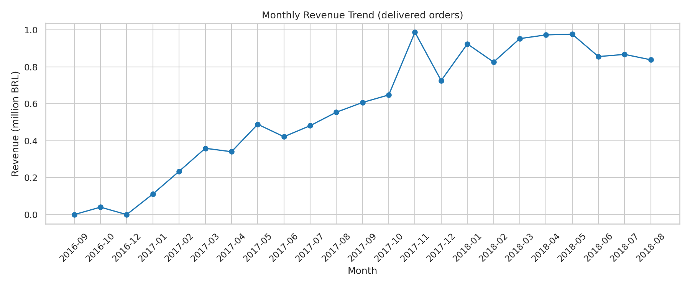
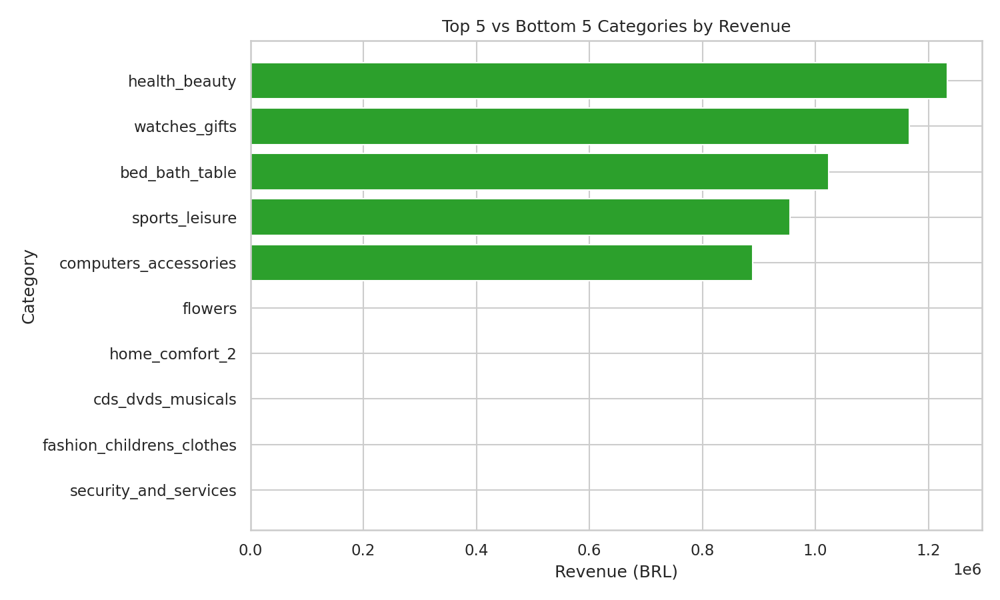
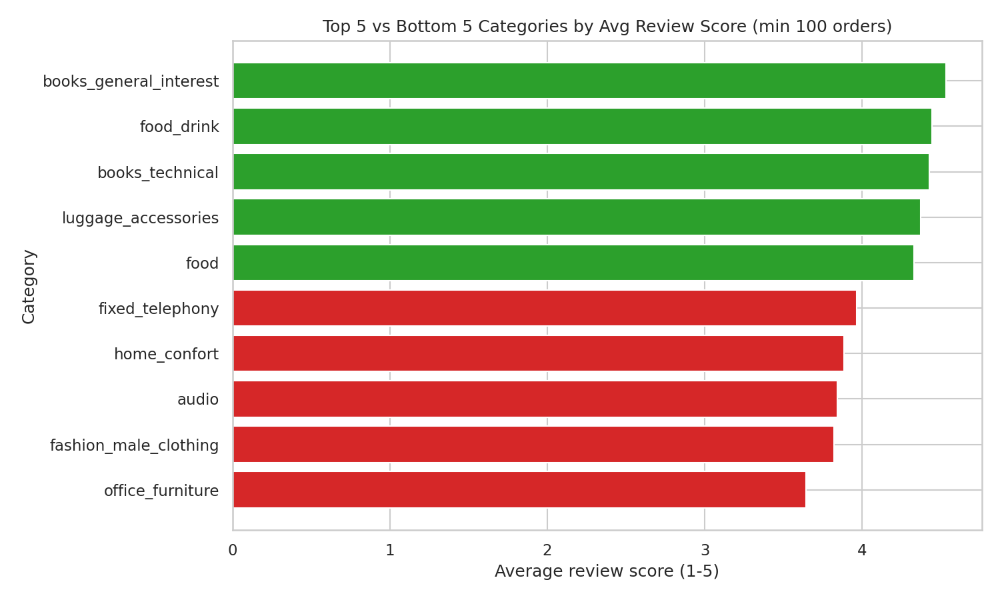
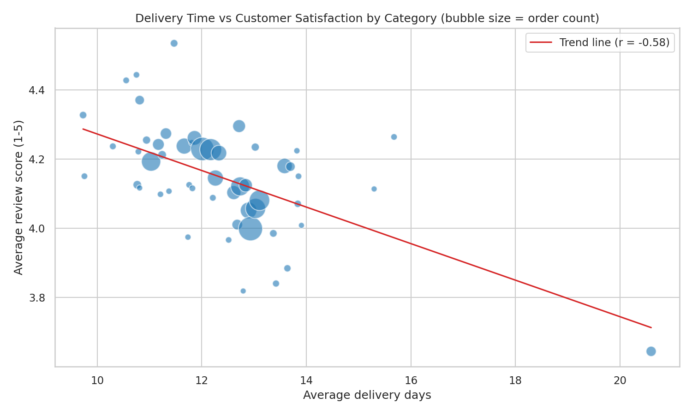

# Charts

The notebook produces four charts. Each one is exported here as a PNG (150 dpi).

> **How these were generated.** The charts were rebuilt by re-running the project's views and queries (Q2, Q6, Q7, Q8, Q10) on the official Olist CSV files in SQLite. Row counts of the three views (110,197 / 96,478 / 97,276) and total revenue (13,221,498.11 BRL) match the Oracle results exactly. Review-based metrics can differ slightly from an Oracle run, because the Oracle reviews table holds more rows than the official file (see [`../dataset/readme.md`](../dataset/readme.md)).

---

## 1. `01_monthly_revenue_trend.png`

- **Question:** how did revenue move month by month?
- **Source:** Q6, `v_order_base`. Delivered orders, grouped by purchase month.
- **Reading it:** the marketplace ramps up through 2017 and reaches a plateau of roughly 0.83–0.98M BRL per month in 2018. The highest month is **November 2017 (987,765 BRL, +52% vs October)**. The first points (Sep–Dec 2016) are based on 1–265 orders and should not be read as a trend.
- **Caution:** the November 2017 jump coincides with Black Friday, but the data does not prove that cause.

## 2. `02_top_bottom_categories_revenue.png`

- **Question:** which categories earn the most, and which the least?
- **Source:** Q7, `v_analytical_base`.
- **Reading it:** green bars are the top 5 (`health_beauty`, `watches_gifts`, `bed_bath_table`, `sports_leisure`, `computers_accessories`, between 0.89M and 1.23M BRL each). Red bars are the bottom 5, all under 1,200 BRL (`flowers`, `home_comfort_2`, `cds_dvds_musicals`, `fashion_childrens_clothes`, `security_and_services`).
- **Caution:** the gap between the two groups is about three orders of magnitude, so the bottom bars are barely visible on a linear axis. That is the finding, not a rendering problem.

## 3. `03_top_bottom_categories_review.png`

- **Question:** which categories satisfy customers most and least?
- **Source:** Q8, `v_order_category`. Only categories with at least 100 orders.
- **Reading it:** the best are `books_general_interest` (4.54), `food_drink` (4.44) and `books_technical` (4.43). The worst is `office_furniture` (3.65, with 1,254 orders), followed by `fashion_male_clothing` (3.82), `audio` (3.84), `home_confort` (3.89) and `fixed_telephony` (3.97).
- **Caution:** `office_furniture` is the only weak category with high volume. `fashion_male_clothing` has 106 orders, so its score is unstable.

## 4. `04_delivery_vs_review.png`

- **Question:** do categories with slower delivery get lower ratings?
- **Source:** Q10. One bubble per category (52 categories with at least 100 orders); bubble size is order count.
- **Reading it:** Pearson r = **−0.58** (Spearman −0.51). Slower categories tend to have lower ratings.
- **Caution:** `office_furniture` (20.6 days, 3.65 score) is a strong outlier. Without it, r falls to −0.42 (Spearman −0.48). This is a correlation between category averages, not a causal effect. Product type, price and seller location can drive both variables.

